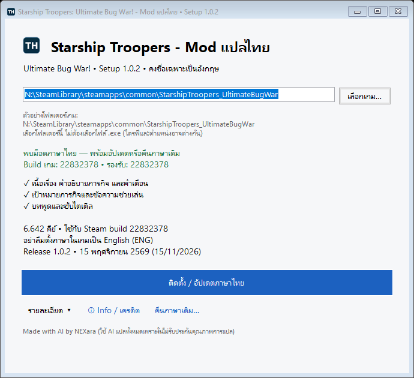
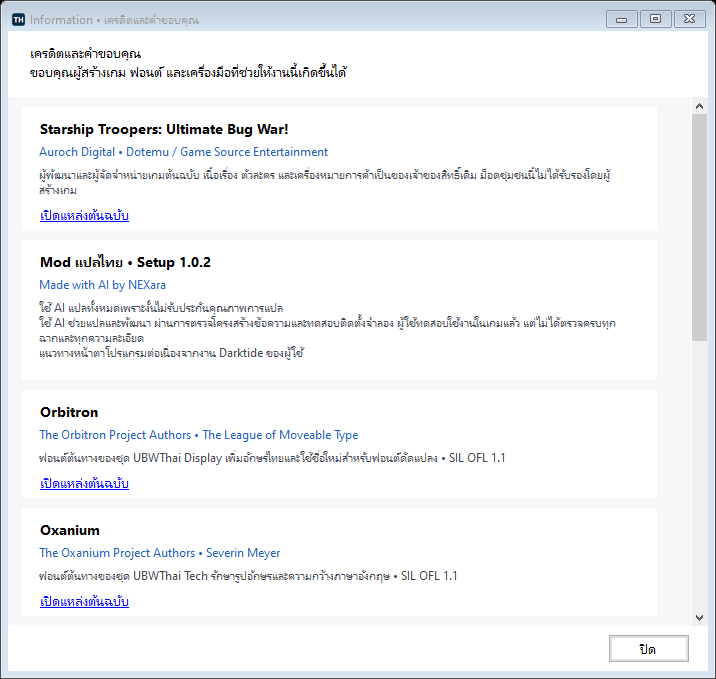

# Starship Troopers: Ultimate Bug War! — Mod แปลไทย

**รุ่นทางการ 1.0.2 • 15 พฤศจิกายน 2569 (15/11/2026)**

แปลเนื้อเรื่อง เป้าหมายภารกิจ ซับบทพูด และข้อความช่วยเล่น โดยคงชื่อคน อาวุธ และศัตรูเป็นอังกฤษเพื่อเทียบกับเกม/ไกด์ได้ง่าย

> Made with AI by NEXara (ใช้ AI แปลทั้งหมดเพราะงั้นไม่รับประกันคุณภาพการแปล)

**[ดาวน์โหลดชุดพร้อมติดตั้ง](https://github.com/NEXara/Starship-Troopers-Ultimate-Bug-War-Thai/releases/latest)** · **[แจ้งคำแปลหรือปัญหา](https://github.com/NEXara/Starship-Troopers-Ultimate-Bug-War-Thai/issues)**

## ดาวน์โหลดและติดตั้ง

ดาวน์โหลด **Starship-Troopers-Ultimate-Bug-War-Thai-1.0.2.zip** จากหน้า Releases ของ repository นี้ — ใช้ชุดพร้อมติดตั้ง แทน Source code (zip)

1. แตก ZIP ลงโฟลเดอร์ใหม่
2. ปิดเกม แล้วเปิด **UBW-Thai-Setup.exe**
3. กด **เลือกเกม…** เลือกโฟลเดอร์หลัก เช่น

   ~~~text
   N:\SteamLibrary\steamapps\common\StarshipTroopers_UltimateBugWar
   ~~~

   ตำแหน่งจริงอาจอยู่ไดรฟ์อื่น ใน Steam ใช้ **Manage → Browse local files** เพื่อหาโฟลเดอร์ ไม่ต้องเลือกไฟล์ .exe

4. กด **ติดตั้ง / อัปเดตภาษาไทย**
5. **อย่าลืมตั้งภาษาในเกมเป็น English (ENG)** และเปิด **Subtitles**

รวมคำแปลและฟอนต์ในตัวติดตั้งแล้ว ไม่ต้องติดตั้ง เครื่องมือพัฒนา หรือม็อดตัวอื่นเพิ่ม ใช้ Windows 10/11 พร้อม .NET Framework 4.8 และเกม Steam build **22832378** ตัวติดตั้งตรวจเวอร์ชันและไฟล์ก่อนติดตั้ง

## หน้าตาโปรแกรม

## ขอบเขตคำแปล

| กลุ่ม | คีย์ |
|---|---:|
| เป้าหมายภารกิจ | 751 |
| บทพูด ซับไตเติล และเสียงบรรยายผู้พัฒนา | 5,287 |
| เนื้อเรื่อง คำอธิบายภารกิจ การสนับสนุน ความสำเร็จ ผลภารกิจ HUD คำเตือน และปุ่มที่เกี่ยวข้อง | 604 |
| รวม | **6,642** |

ตัวเลขรวมชื่อเฉพาะ/เสียงที่ตั้งใจคงภาษาเดิมบางรายการ ไม่ใช่การอ้างว่าข้อความทุกอย่างในเกมถูกแปลแล้ว

ชื่อคน อาวุธ ศัตรู การสนับสนุน ชื่อปฏิบัติการบางรายการ เมนู/หน้าตั้งค่าส่วนใหญ่ ชื่อปุ่มอุปกรณ์ และเครดิต/ประกาศสิทธิ์ของเกมยังเป็นภาษาอังกฤษ ไม่ได้เปลี่ยนเสียงพากย์หรือป้ายที่ฝังในภาพ

## อัปเดตและคืนภาษาเดิม

ปิดเกม แล้วใช้ปุ่มติดตั้ง / อัปเดต หรือ **คืนภาษาเดิม…** ในโปรแกรมเดียวกัน เลือกโฟลเดอร์เกมเดิม

อัปเดตจากชุดก่อนหน้าได้ผ่านตัวติดตั้ง โปรแกรมตรวจไฟล์ก่อนอัปเดตและรองรับชุดทดลองที่รู้จัก

ม็อดเพิ่มชุดแปลใน Content/Paks/~mods ไม่เขียนทับ archive เกมต้นฉบับ ไม่แก้เซฟ/ไฟล์ ReShade และไม่เปิดเกมอัตโนมัติ หากไฟล์ถูกแก้ไขหรือไม่ตรงกับชุดที่รู้จัก โปรแกรมจะปฏิเสธการเขียนทับ/ลบ

## สถานะการตรวจและข้อจำกัด

ผู้ใช้ทดสอบใช้งานจริงและยืนยันแล้ว ผ่านการตรวจโครงสร้างทุกคีย์ในขอบเขต การอ่านแพ็กกลับ อักษรไทย/ระยะฟอนต์ 16 รายการ และ 32 ข้อทดสอบตัวติดตั้งจำลอง

ไม่ได้เล่นตรวจทุกฉาก ทุกบรรทัด ทุกความละเอียด หรือทุกชุดม็อด ข้อความเก็บตกก่อนเผยแพร่ตรวจจากต้นฉบับและแพ็ก แต่ยังไม่ได้เล่นยืนยันทุกคีย์ในเกม ไม่รับรองเกมอัปเดตอื่น

HUD Scaling ปรับขนาด HUD รวม และ Safe Zone ปรับระยะขอบจอ ยังไม่มีตัวเลือกขยายซับเฉพาะส่วนในตัวติดตั้ง

หากพบปัญหา เปิด Issue พร้อมภาพ ชื่อภารกิจ เหตุการณ์ รุ่นม็อด และ build เกม

## เครดิต ใบอนุญาต และ AI

อ่าน [เครดิต](CREDITS.txt) และ [Third-party notices](THIRD_PARTY_NOTICES.txt) ฟอนต์ดัดแปลงใช้ SIL OFL 1.1 พร้อมประกาศลิขสิทธิ์ใน [licenses](licenses)

เกมโดย Auroch Digital; จัดจำหน่ายโดย Dotemu / Game Source Entertainment ทรัพย์สินเกมและเครื่องหมายการค้าเป็นของเจ้าของสิทธิ์เดิม ม็อดชุมชนนี้ไม่ได้รับรองโดยผู้สร้างเกม

คำแปล โค้ดตัวติดตั้ง เอกสาร และไอคอน TH จัดทำด้วย AI โดย NEXara

## สำหรับผู้ตรวจซอร์ส

ซอร์สตัวติดตั้งอยู่ใน [source](source) และขั้นตอนคอมไพล์อยู่ใน [BUILD](docs/BUILD.md) ใช้ payload จากตัวติดตั้งรุ่นที่ตรวจ hash แล้ว เพื่อไม่แจก archive เกมต้นฉบับหรือเครื่องมือแตกไฟล์ใน repository

Release 1.0.2 คงปุ่มเมนูและปุ่มคำสั่งเป็นอังกฤษ รวมหน้าพักเกมและหน้าตาย คีย์หัวข้อที่ใช้ร่วมกับปุ่มจะเป็นอังกฤษด้วย ข้อความเนื้อเรื่อง เป้าหมาย ซับ และคำอธิบายยังเป็นไทย
